# Atrium for Orca

[中文说明](README.zh-CN.md)

An [Orca](https://github.com/stablyai/orca) plugin that brings Atrium's **projects** (controller → leads → workers, milestones, task board, team roster with stand-ins, autopilot) and **workflows** (templates, runs, gates, send-back, per-item steps, experience notes) into Orca with a visual interface.

## What it does

- **Atrium sidebar**: Surfaces everything that needs your attention first (gates, agent questions, stalled or blocked agents, quota handoffs), plus live project cards with autopilot toggles and running workflow cards.
- **Project command center (`atrium.board`)**: Org chart with live agent status rings and quota bars, Kanban task board with milestone swimlanes and drag-and-drop status updates, team roster editor with stand-in chains, and activity feed.
- **Workflow run view (`.atrium-run`)**: Interactive SVG DAG showing step states, per-item grids for `each` steps, check logs, attempt history, gate choices, send-back with notes, and pause/resume/cancel controls.
- **Visual template editor (`.workflow.toml`)**: Split view with a step/edge editor alongside live-synced TOML and inline validation errors.
- **Agent bridge**: Injects `atrium` onto launched agents' `PATH` and connects over a local socket/pipe so agents can run `atrium report`, `atrium task done|blocked`, `atrium notice`, and `atrium ask`.

## Screenshots

| View | Light | Dark |
| --- | --- | --- |
| Sidebar |  | 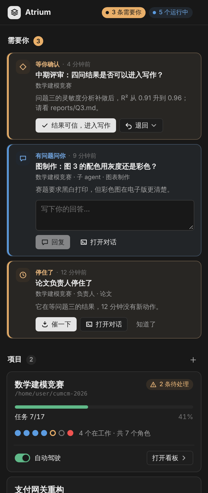 |
| Project board | 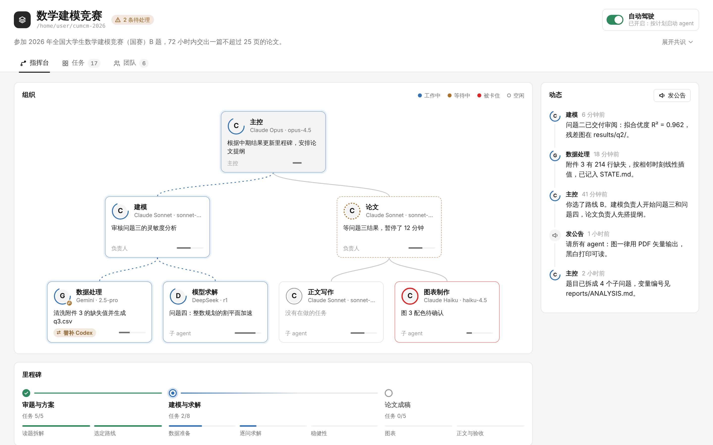 | 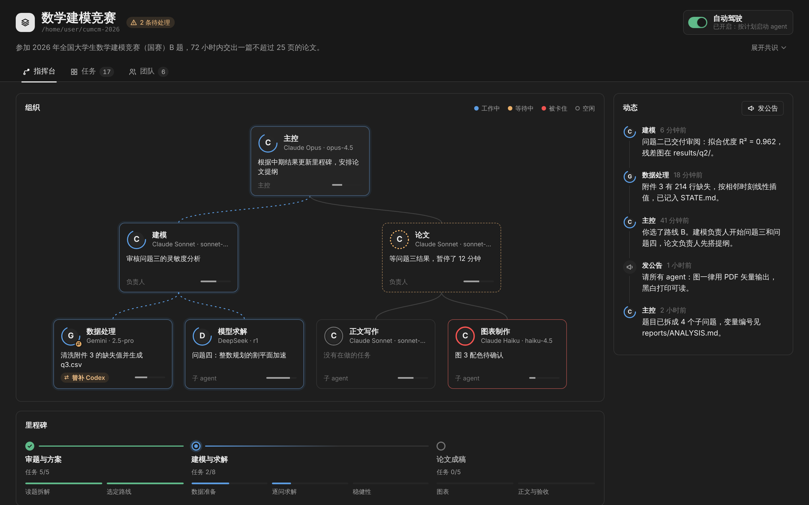 |
| Task Kanban | 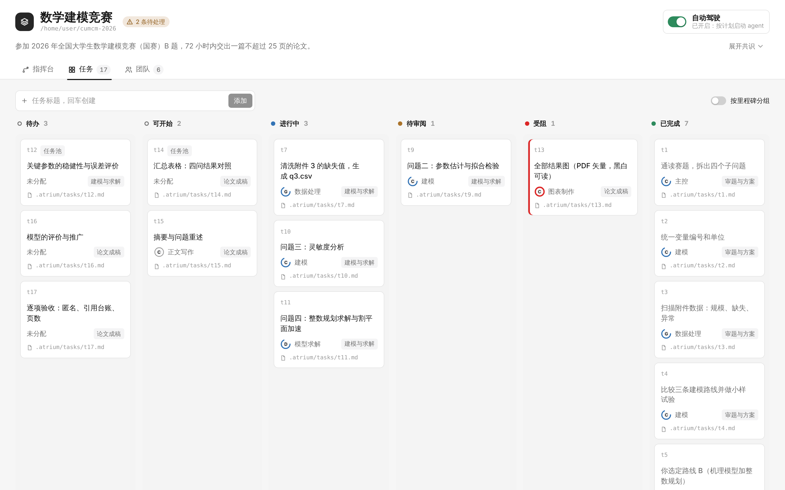 | 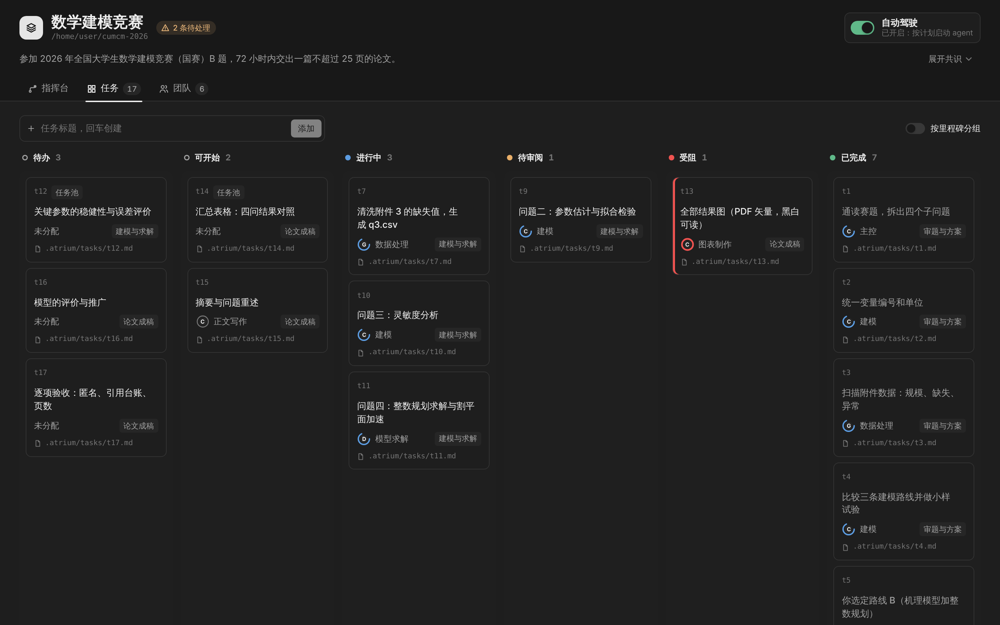 |
| Team roster | 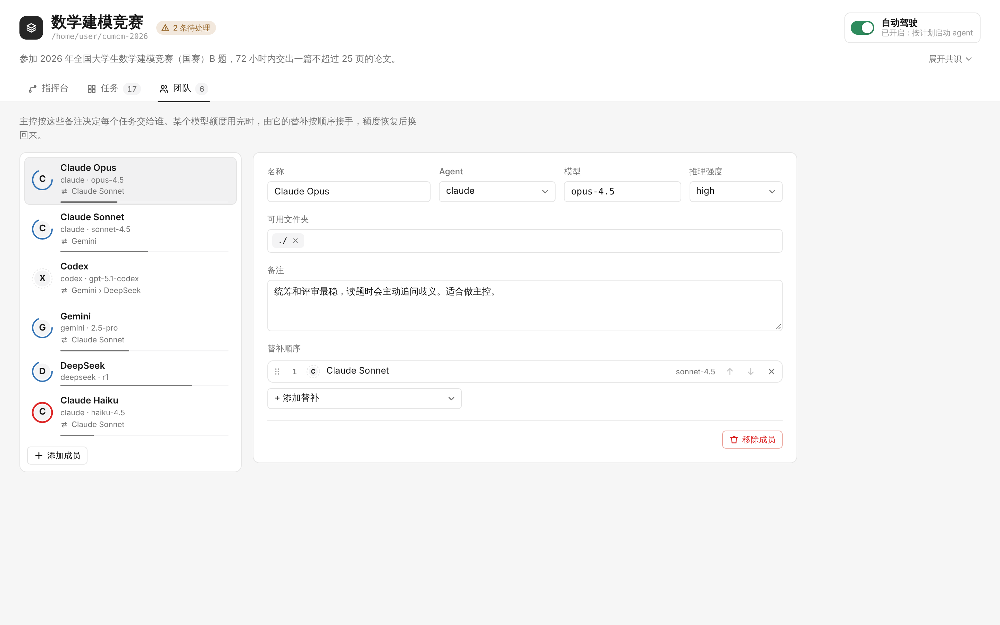 | 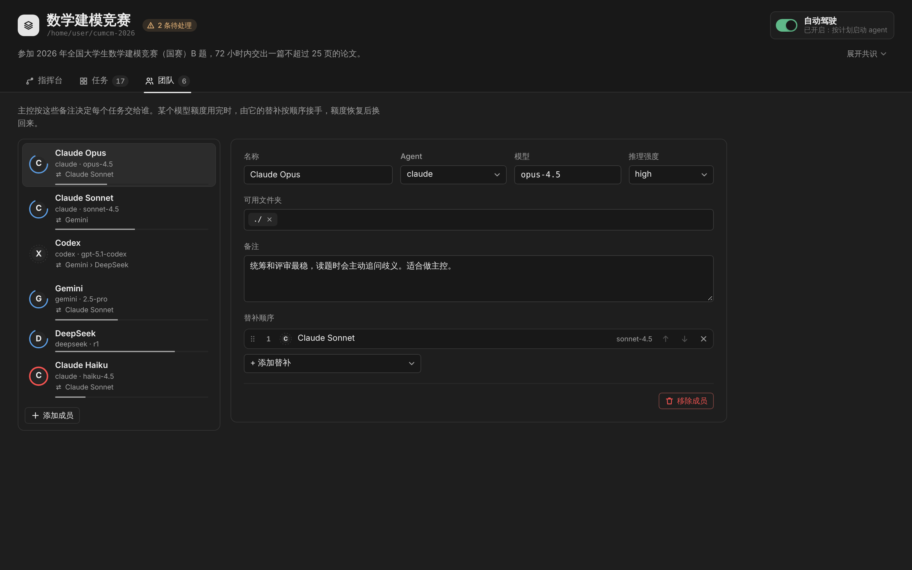 |
| Workflow run | 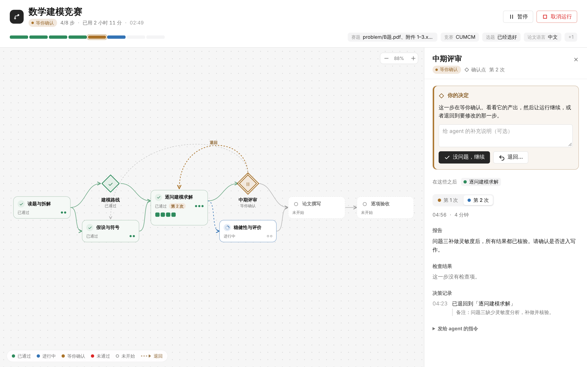 | 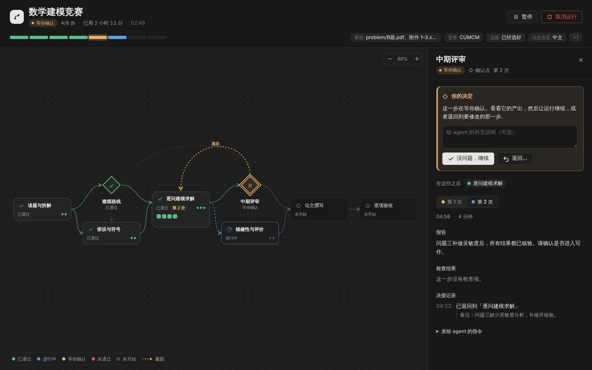 |
| Template editor | 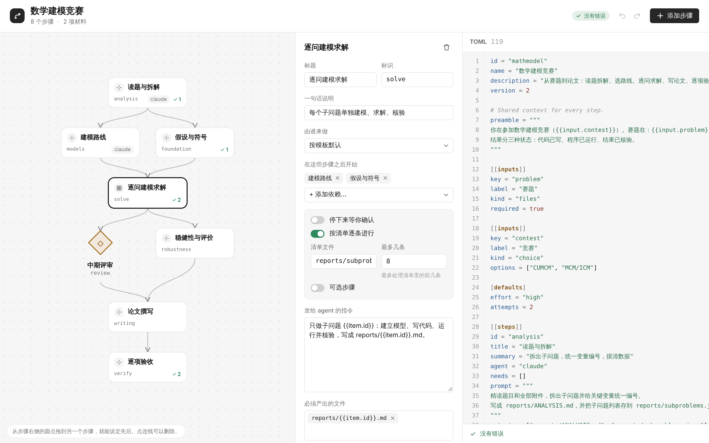 | 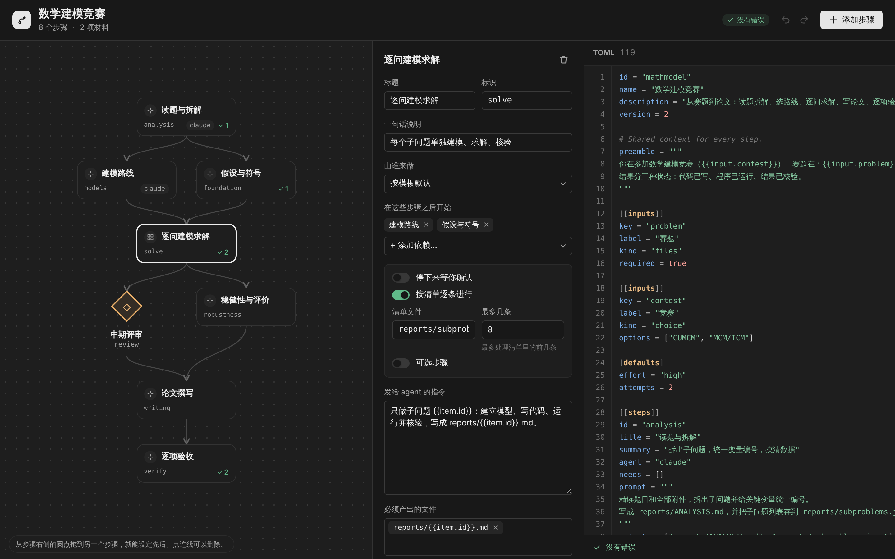 |

## Requirements

- **Orca**: `1.4.259` or later (plugin API v1, `trusted-worker` execution).
- **Build from source** (only if modifying code):
  - Node.js `>= 20` and npm
  - Rust toolchain with the `wasm32-wasip1` target (`rustup target add wasm32-wasip1`)

## Load as a dev plugin

From `plugins/orca-atrium/`:

```sh
npm install
npm run build
orca plugin dev load .
```

Orca will display the capabilities requested by `orca-plugin.json` (`workspace:read/write/create`, `agent:read/launch`, `terminal:read/send`, `storage:own`, `settings:own`, `notifications:show`, `automation:read`, `history:read`) for approval before activating the plugin.

To reload after rebuilding:

```sh
orca plugin dev reload .
```

## Build

```sh
cd plugins/orca-atrium
npm install
npm run build
```

`npm run build` runs:

1. `npm run build:core` — compiles `crates/atrium-orca-core` for `wasm32-wasip1` (`--profile wasm-release`) and copies the binary to `core/atrium_core.wasm`.
2. `npm run build:worker` — bundles `worker/src/main.ts` to `worker/dist/main.mjs`.
3. `npm run build:ui` — installs UI dependencies if needed and bundles the four HTML views into `ui/dist/`.

To run tests and checks:

```sh
npm run typecheck
npm test
cargo test -p atrium-orca-core
cargo clippy -p atrium-orca-core -- -D warnings
```

## File sharing with the Atrium app

The plugin uses the **same on-disk format and directories** as the Atrium desktop app through the shared Rust core (`atrium-orca-core`):

- **Project state**: `<project>/.atrium/` (`brief.md`, `plan.md`, `team.toml`, `tasks/`, `notices.jsonl`, etc.). The plugin also writes `<project>/.atrium/atrium.board` (kept out of git via `.atrium/.gitignore`) so Orca opens the project command center custom editor.
- **Workflow templates**: Built-in templates, user templates in `~/.config/Atrium/workflows/`, and project templates in `<project>/.atrium/workflows/`.
- **Workflow runs**: `<run dir>/.atrium/run.json`, `log.jsonl`, and `view.atrium-run` (for Orca's run custom editor).

Because all state is persisted in these files, projects and workflow runs can move freely between the Atrium desktop app and Orca.
