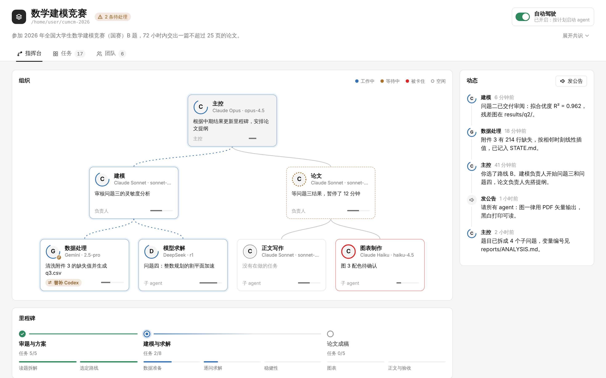
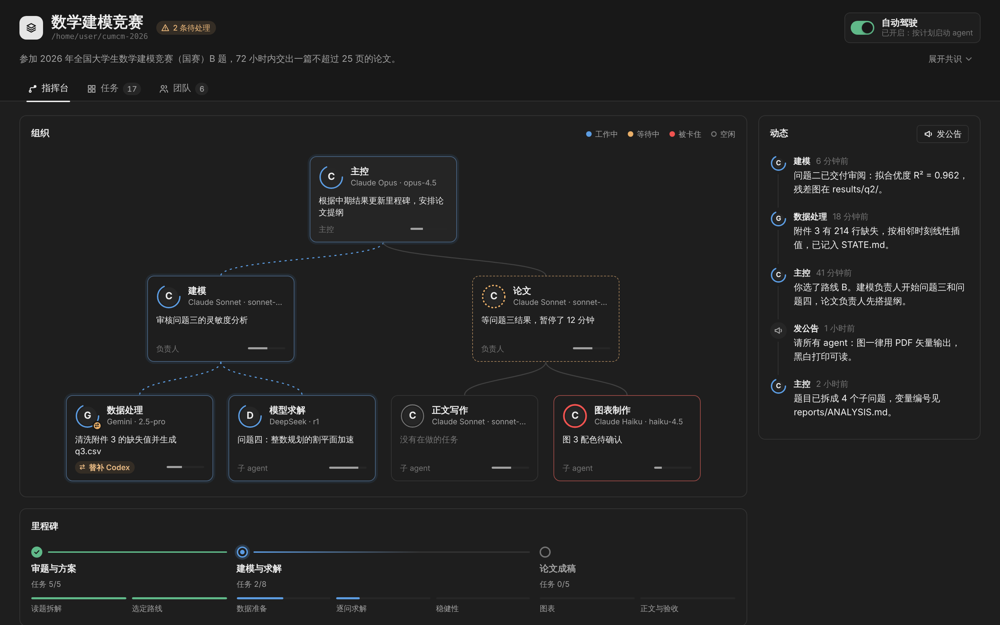
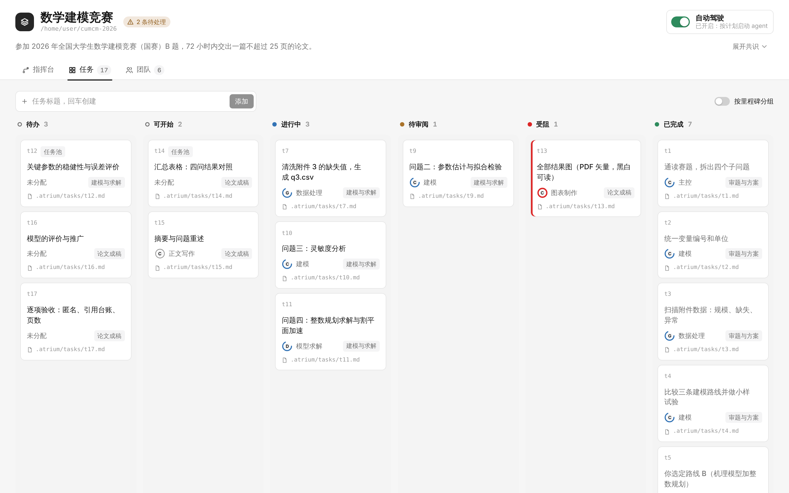
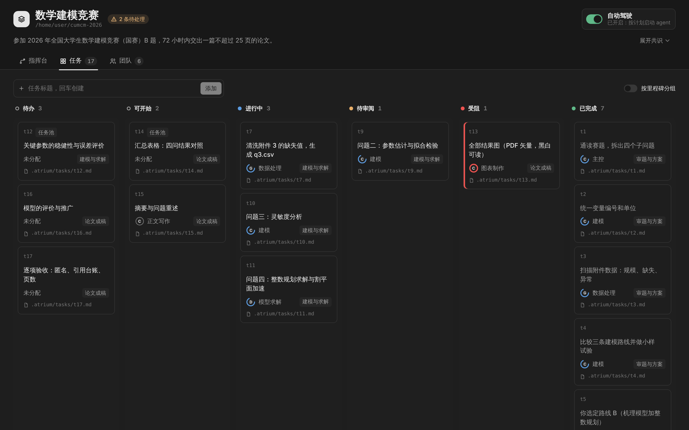
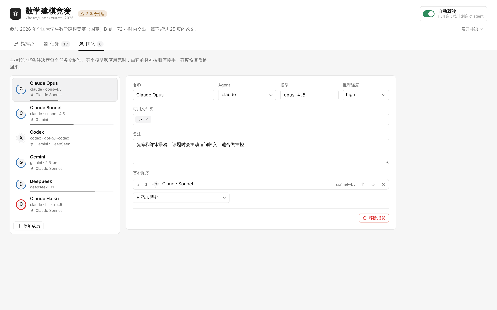
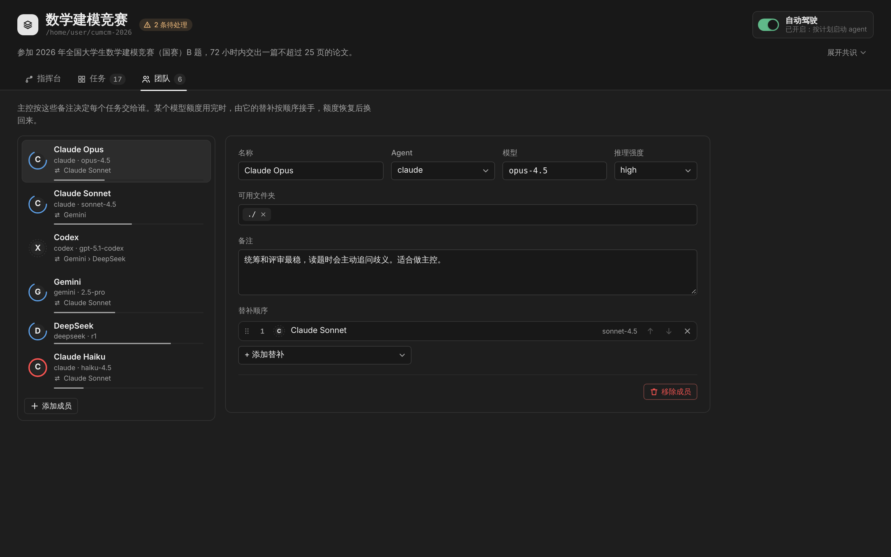
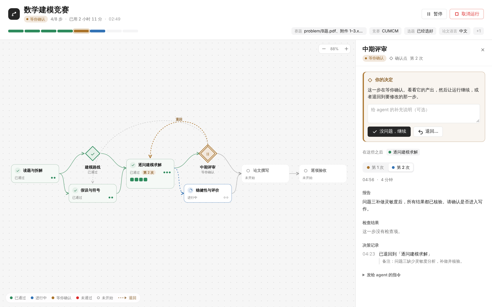
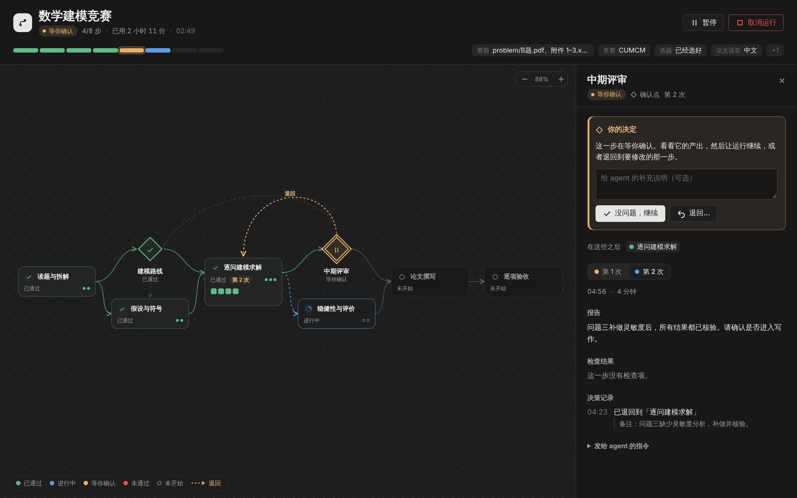
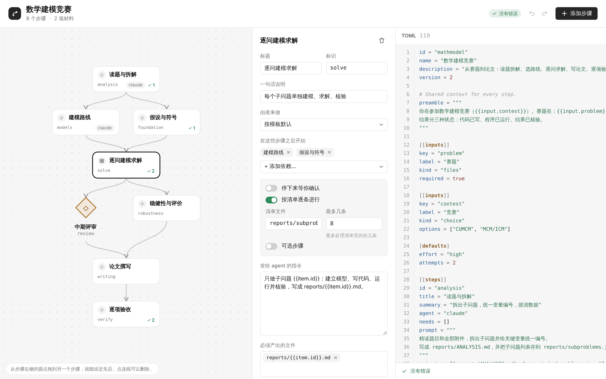
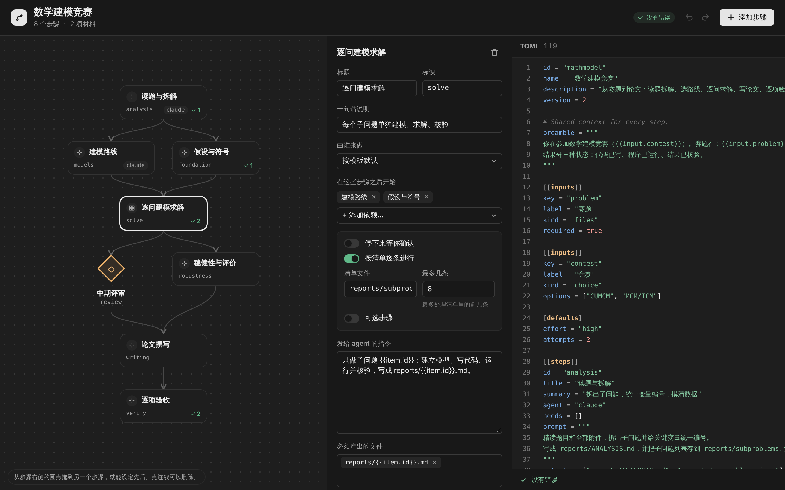

# Atrium for Orca

[English](README.md)

将 Atrium 的**项目协作**（总控 → 组长 → 执行者、里程碑、任务看板、团队名册与替补链、自动驾驶）与**工作流编排**（模板、运行实例、审批关口、打回修改、逐项步骤、经验记录）带入 [Orca](https://github.com/stablyai/orca) 的可视化插件。

## 功能概览

- **Atrium 侧边栏**：优先展示「需要你」处理的所有事项（审批关口、Agent 提问、卡住或阻塞的 Agent、额度耗尽切换），以及带有自动驾驶开关的项目卡片和运行中的工作流卡片。
- **项目指挥中心（`atrium.board`）**：带实时状态环与额度条的组织架构图、支持里程碑泳道与拖拽流转的 Kanban 任务看板、支持替补顺序编排的团队名册编辑器，以及动态信息流。
- **工作流运行视图（`.atrium-run`）**：交互式 SVG DAG 步骤图，支持 `each` 逐项状态网格、检查日志、历史尝试记录、自定义关口选项按钮、带意见退回，以及暂停/恢复/取消控制。
- **可视化模板编辑器（`.workflow.toml`）**：左侧表单/步骤连线编辑与右侧 TOML 文本实时双向同步，并内联显示行号级校验错误。
- **Agent 通信桥接**：通过 `agent.launch.before` 将 `atrium` 命令注入 Agent 的 `PATH`，并通过本地 Socket / 命名管道回传 `atrium report`、`atrium task done|blocked`、`atrium notice` 与 `atrium ask`。

## 界面截图

| 视图 | 浅色主题 | 深色主题 |
| --- | --- | --- |
| 侧边栏 |  |  |
| 项目指挥中心 |  |  |
| 任务看板 |  |  |
| 团队名册 |  |  |
| 工作流运行 |  |  |
| 模板编辑器 |  |  |

## 环境要求

- **Orca**：`1.4.259` 或更高版本（plugin API v1，`trusted-worker` 模式）。
- **从源码构建**（仅修改代码时需要）：
  - Node.js `>= 20` 与 npm
  - Rust 工具链及 `wasm32-wasip1` 目标（`rustup target add wasm32-wasip1`）

## 作为开发插件加载

在 `plugins/orca-atrium/` 目录下执行：

```sh
npm install
npm run build
orca plugin dev load .
```

Orca 会列出 `orca-plugin.json` 声明的权限（`workspace:read/write/create`、`agent:read/launch`、`terminal:read/send`、`storage:own`、`settings:own`、`notifications:show`、`automation:read`、`history:read`），确认批准后即可启用。

修改构建后重新加载：

```sh
orca plugin dev reload .
```

## 构建与测试

```sh
cd plugins/orca-atrium
npm install
npm run build
```

`npm run build` 会依次执行：

1. `npm run build:core` — 将 `crates/atrium-orca-core` 编译为 `wasm32-wasip1`（`--profile wasm-release`）并复制到 `core/atrium_core.wasm`。
2. `npm run build:worker` — 将 `worker/src/main.ts` 打包为 `worker/dist/main.mjs`。
3. `npm run build:ui` — 将四个界面视图打包至 `ui/dist/`。

运行类型检查、单元测试与 Clippy：

```sh
npm run typecheck
npm test
cargo test -p atrium-orca-core
cargo clippy -p atrium-orca-core -- -D warnings
```

## 与 Atrium 桌面端共享文件

插件通过共享的 Rust 核心（`atrium-orca-core`）直接读写与 Atrium 桌面端**完全一致的磁盘文件与目录**：

- **项目状态**：`<项目目录>/.atrium/`（`brief.md`、`plan.md`、`team.toml`、`tasks/`、`notices.jsonl` 等）。插件会在该目录下写入 `atrium.board` 链接文件（并通过 `.atrium/.gitignore` 忽略），以便 Orca 打开项目指挥中心自定义编辑器。
- **工作流模板**：内置模板、用户模板目录 `~/.config/Atrium/workflows/`，以及项目模板目录 `<项目目录>/.atrium/workflows/`。
- **工作流运行**：`<运行目录>/.atrium/run.json`、`log.jsonl` 及 `view.atrium-run` 链接文件。

所有运行与协作状态均持久化在这些文件中，因此项目与工作流可以在 Atrium 桌面端与 Orca 之间无缝切换。
